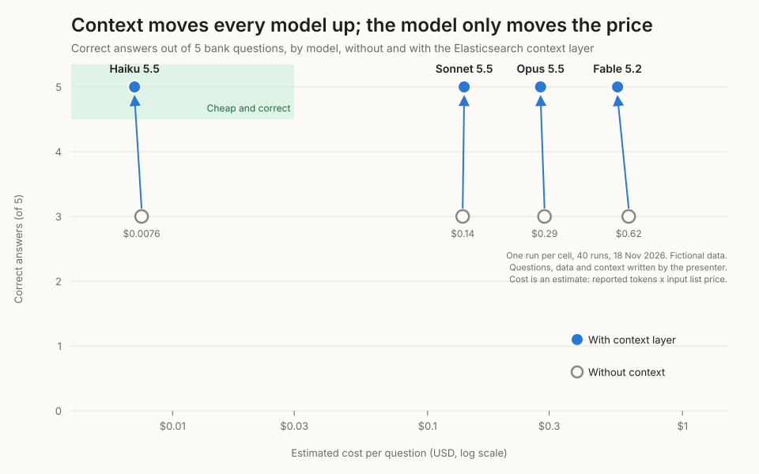

# Model matrix: four models, with and without the context layer

| Model | Context | Correct (of 5) | Queries per question | Seconds | Tokens | Est. cost per question |
|---|---|---|---|---|---|---|
| Haiku 5.5 | No | 3 | 5.8 | 28 | 75,596 | $0.0076 |
| Haiku 5.5 | Yes | 5 | 2.4 | 18 | 70,923 | $0.0071 |
| Sonnet 5.5 | No | 3 | 6.2 | 15 | 68,661 | $0.14 |
| Sonnet 5.5 | Yes | 5 | 2.0 | 10 | 69,609 | $0.14 |
| Opus 5.5 | No | 3 | 7.0 | 25 | 71,901 | $0.29 |
| Opus 5.5 | Yes | 5 | 2.0 | 13 | 69,369 | $0.28 |
| Fable 5.2 | No | 3 | 8.0 | 25 | 76,893 | $0.62 |
| Fable 5.2 | Yes | 5 | 2.4 | 13 | 69,541 | $0.56 |

## What it shows

- Every model scored 3 of 5 without context and 5 of 5 with it.
- Without context, all four models failed the same two questions, the ones that need a bank definition (material outsourcing, reportable incident). Each said it found no definition and guessed.
- Haiku 5.5 with context was right on all five at an estimated USD 0.007 per question. Fable 5.2 without context was right on three at about USD 0.62.

## Read this with care

- One run per cell. Agents are not deterministic.
- Five questions, written together with the data and the context by the same person. Two of them were chosen because they need a definition.
- Cost is an estimate: tokens reported by Claude Code times the model's input list price (USD per million: Haiku 0.10, Sonnet 2, Opus 4, Fable 8). It ignores cache discounts and the higher output price. About 65,000 of each run's roughly 70,000 tokens are Claude Code's own overhead, so the chart shows the price gap between models, not token savings from context. For token savings use `../RESULTS.md`.
- The agents ran as Claude Code subagents with `agent/baseline` and `agent/with-context` instructions. Raw rows: `runs.csv`. Rebuild: `python3 build_chart.py`.
