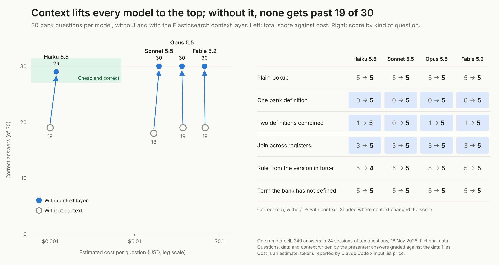

# Model matrix, 30 questions

| Model | Context | Correct (of 30) | Queries per question | Seconds per question | Est. cost per question |
|---|---|---|---|---|---|
| Haiku 5.5 | No | 19 | 2.0 | 7.1 | $0.001 |
| Haiku 5.5 | Yes | 29 | 2.1 | 7.5 | $0.0012 |
| Sonnet 5.5 | No | 18 | 2.1 | 3.4 | $0.017 |
| Sonnet 5.5 | Yes | 30 | 2.1 | 4.5 | $0.019 |
| Opus 5.5 | No | 19 | 2.2 | 4.7 | $0.037 |
| Opus 5.5 | Yes | 30 | 1.9 | 7.1 | $0.036 |
| Fable 5.2 | No | 19 | 2.2 | 4.5 | $0.068 |
| Fable 5.2 | Yes | 30 | 1.8 | 3.7 | $0.067 |

## By kind of question (correct of 5, without → with context)

| Kind | Haiku 5.5 | Sonnet 5.5 | Opus 5.5 | Fable 5.2 |
|---|---|---|---|---|
| Plain lookup | 5 → 5 | 5 → 5 | 5 → 5 | 5 → 5 |
| One bank definition | 0 → 5 | 0 → 5 | 0 → 5 | 0 → 5 |
| Two definitions combined | 1 → 5 | 0 → 5 | 1 → 5 | 1 → 5 |
| Join across registers | 3 → 5 | 3 → 5 | 3 → 5 | 3 → 5 |
| Rule from the version in force | 5 → 4 | 5 → 5 | 5 → 5 | 5 → 5 |
| Term the bank has not defined | 5 → 5 | 5 → 5 | 5 → 5 | 5 → 5 |

## What it shows

- Without context every model scored 18 or 19 of 30. With context every model scored 29 or 30.
- The gap is entirely in questions that need a bank definition: alone, combined, or inside a join. Lookups, rules from the policy in force and undefined terms were answered correctly either way.
- Of the 45 baseline misses, 41 were the answer UNDEFINED and 4 were wrong records. The prompt told both agents not to guess, so the baseline mostly declined instead of guessing.
- With context no model invented a meaning for the five terms the bank has not defined.
- The one miss with context: Haiku 5.5 answered UNDEFINED for the retention period of recorded trading calls (Q23).
- The four models still do not separate. On this set the context layer decides the score and the model decides the price.

## Read this with care

- One run per cell. Agents are not deterministic.
- 30 questions, written together with the data and the context by the same person. 15 of the 30 depend on a definition that exists only in the context layer, so the baseline score mostly reflects that share.
- Ten questions per session. A baseline session explores once and reuses what it learned, so queries, seconds and cost per question are lower than in the 5-question run (`../matrix/`) and not comparable with it.
- Cost is an estimate: session tokens / 10 x the model's input list price (USD per million: Haiku 0.10, Sonnet 2, Opus 4, Fable 8). It ignores cache discounts and the output price. Most tokens are Claude Code's own overhead.
- Six of the definitions give the rule in words only, with no ready query; the agent composed the query itself.

Files: `questions.py` (questions and how each expected answer is computed), `answers/` (raw answers), `graded.csv`, `usage.csv`, `grade.py`, `build_chart.py`.
